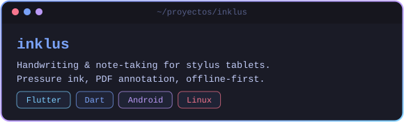
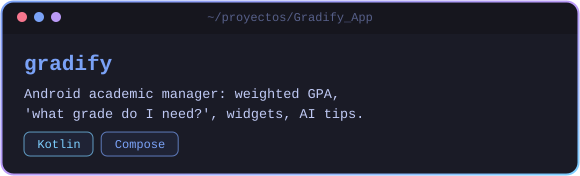
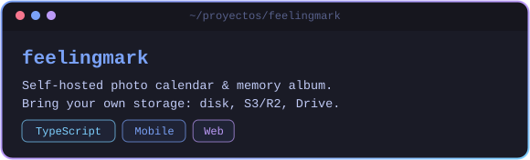
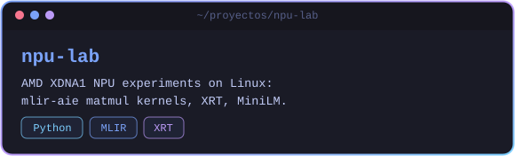
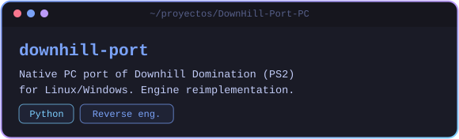
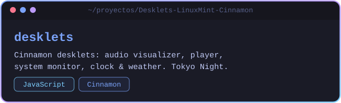

  <picture>
    <source media="(prefers-color-scheme: dark)" srcset="assets/banner/dark.svg"/>
    <source media="(prefers-color-scheme: light)" srcset="assets/banner/light.svg"/>
    
  </picture>

  
  
  

  <picture>
    <source media="(prefers-color-scheme: dark)" srcset="assets/headers/about-dark.svg"/>
    <source media="(prefers-color-scheme: light)" srcset="assets/headers/about-light.svg"/>
    
  </picture>

- Software Engineering @ **Universidad del Quindío**, Armenia 🇨🇴 · Junior **Cybersecurity** analyst
- Into software & web **architecture**, clean backends, Wayland and low-level stuff
- Building [Inklus](https://github.com/Pedroj-64/inklus) and [Gradify](https://github.com/Pedroj-64/Gradify_App); learning Rust, C/C++, TypeScript and Angular
- Linux + Tokyo Night everything 🦎

  <picture>
    <source media="(prefers-color-scheme: dark)" srcset="assets/headers/proyectos-dark.svg"/>
    <source media="(prefers-color-scheme: light)" srcset="assets/headers/proyectos-light.svg"/>
    
  </picture>

<table align="center">
<tr><td><a href="https://github.com/Pedroj-64/inklus"><picture>
  <source media="(prefers-color-scheme: dark)" srcset="assets/cards/inklus-dark.svg"/>
  <source media="(prefers-color-scheme: light)" srcset="assets/cards/inklus-light.svg"/>
  
</picture></a></td><td><a href="https://github.com/Pedroj-64/Gradify_App"><picture>
  <source media="(prefers-color-scheme: dark)" srcset="assets/cards/gradify-dark.svg"/>
  <source media="(prefers-color-scheme: light)" srcset="assets/cards/gradify-light.svg"/>
  
</picture></a></td></tr>
<tr><td><a href="https://github.com/Pedroj-64/feelingmark"><picture>
  <source media="(prefers-color-scheme: dark)" srcset="assets/cards/feelingmark-dark.svg"/>
  <source media="(prefers-color-scheme: light)" srcset="assets/cards/feelingmark-light.svg"/>
  
</picture></a></td><td><a href="https://github.com/Pedroj-64/npu-lab"><picture>
  <source media="(prefers-color-scheme: dark)" srcset="assets/cards/npu-lab-dark.svg"/>
  <source media="(prefers-color-scheme: light)" srcset="assets/cards/npu-lab-light.svg"/>
  
</picture></a></td></tr>
<tr><td><a href="https://github.com/Pedroj-64/DownHill-Port-PC"><picture>
  <source media="(prefers-color-scheme: dark)" srcset="assets/cards/downhill-port-dark.svg"/>
  <source media="(prefers-color-scheme: light)" srcset="assets/cards/downhill-port-light.svg"/>
  
</picture></a></td><td><a href="https://github.com/Pedroj-64/Desklets-LinuxMint-Cinnamon"><picture>
  <source media="(prefers-color-scheme: dark)" srcset="assets/cards/desklets-dark.svg"/>
  <source media="(prefers-color-scheme: light)" srcset="assets/cards/desklets-light.svg"/>
  
</picture></a></td></tr>
</table>

  <picture>
    <source media="(prefers-color-scheme: dark)" srcset="assets/headers/actividad-dark.svg"/>
    <source media="(prefers-color-scheme: light)" srcset="assets/headers/actividad-light.svg"/>
    
  </picture>

  
  

  <picture>
    <source media="(prefers-color-scheme: dark)" srcset="https://raw.githubusercontent.com/Pedroj-64/Pedroj-64/output/github-contribution-grid-snake-dark.svg"/>
    <source media="(prefers-color-scheme: light)" srcset="https://raw.githubusercontent.com/Pedroj-64/Pedroj-64/output/github-contribution-grid-snake.svg"/>
    
  </picture>

